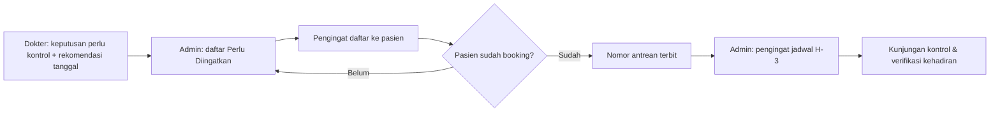
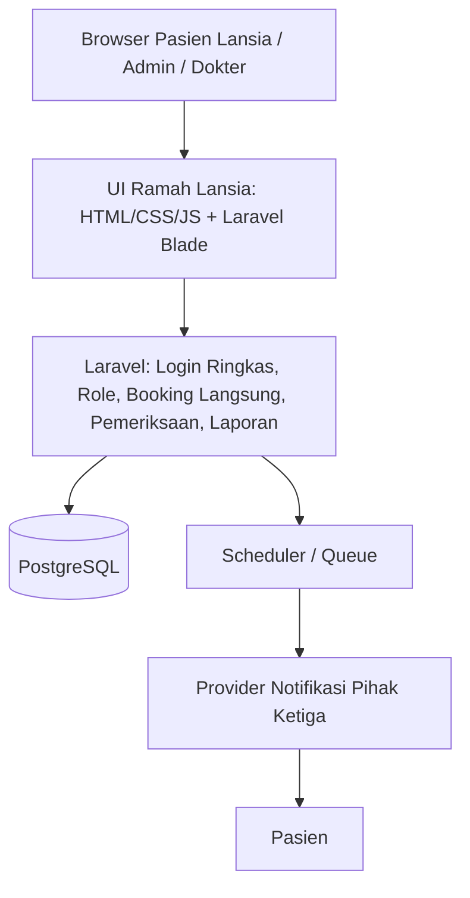

# Product Requirements Document (PRD)

# PULIH

**Sistem Manajemen Kontrol Pasien Penyakit Tidak Menular (PTM)**

| Informasi       | Detail                                                                                    |
| --------------- | ----------------------------------------------------------------------------------------- |
| Nama aplikasi   | **PULIH**                                                                                 |
| Jenis produk    | Aplikasi web manajemen kontrol pasien PTM                                                 |
| Versi dokumen   | 1.4 (Penyelarasan 8 Fitur Inti: Registrasi, Aktivasi Akun, Lihat Jadwal, Booking, Lihat Nomor Antrean, Reminder Kontrol, Riwayat Kontrol, dan Verifikasi Kehadiran) |
| Tanggal dokumen | 23 November 2026                                                                          |
| Status          | Siap review akhir dan pengesahan Product Owner                                            |
| Tim             | Tim affh iyh                                                                              |
| Project Manager | Didar Muktafa Billah                                                                      |
| Stack           | HTML, CSS, JavaScript, Laravel (PHP), PostgreSQL                                          |
| Lingkungan      | Development, staging, production                                                          |

> **Kaidah dokumen:** Kebutuhan dari charter, daftar fitur, swimlane, dan keputusan produk terbaru (UX ramah lansia, halaman utama langsung booking, login nama + tanggal lahir/kode acak, serta aktivasi akun mengikuti keputusan dokter) berlaku sebagai baseline. Parameter operasional/target numerik yang belum ditetapkan oleh pihak layanan kesehatan atau manajemen tetap ditandai secara eksplisit agar tidak diasumsikan.

---

## 1. Ringkasan Produk

**PULIH** adalah aplikasi web untuk mendukung tindak lanjut kontrol pasien Penyakit Tidak Menular (PTM) pada layanan kesehatan, dengan desain yang berfokus pada **kemudahan penggunaan bagi orang tua/lansia** yang menginginkan alur sederhana dan langsung ke inti. Sistem mencatat hasil pemeriksaan, memfasilitasi rekomendasi jadwal kontrol oleh dokter, membantu pasien melihat jadwal kontrol dan melakukan booking kontrol ulang langsung dari halaman utama tanpa harus datang ke lokasi, menampilkan nomor antrean agar pasien tidak menunggu lama, mencatat riwayat kontrol untuk memantau perkembangan kesehatan, meneruskan **pengingat kontrol dari dokter melalui admin** kepada pasien (sebelum dan sesudah booking) agar pasien tidak terlewat kontrol medis, serta membantu admin meregistrasi, mengaktifkan akun pasien siap pakai, dan memverifikasi kehadiran untuk menyusun ketersediaan slot antrean secara efektif.

Sistem juga mencatat kategori kepesertaan pasien (**BPJS** atau **non-BPJS**) serta memisahkan alur akun berdasarkan keputusan medis dokter:

- Jika dokter memutuskan pasien **perlu kontrol lanjutan**, admin membuat dan mengaktifkan akun pasien agar dapat langsung pakai untuk melihat jadwal, melakukan booking, melihat nomor antrean, riwayat kontrol, dan hasil pemeriksaan.
- Jika dokter memutuskan pasien **perlu dirujuk**, admin **tidak membuat/mengaktifkan akun kontrol** (status dicatat sebagai rujuk) dan hanya membantu pencatatan administrasi surat rujukan yang diterbitkan dokter.

### 1.1 Masalah yang Diselesaikan

Dokumen ini secara spesifik mengatasi 8 kendala operasional dan pengalaman pengguna di fasilitas kesehatan:

1. **Pasien pelupa terlewat jadwal kontrol medis:** Pasien (terutama lansia dengan sifat pelupa) kerap terlewat dari tanggal kontrol rutin sehingga pengobatan PTM terputus dan angka _no-show_ meningkat.
2. **Tabrakan jadwal kontrol & penumpukan pasien:** Ketiadaan visibilitas jadwal membuat pasien tidak mengetahui jadwal kontrol dokter dan slot pasien lain, menimbulkan tabrakan jadwal dan penumpukan pasien pada jam yang sama.
3. **Waktu tunggu lama di lokasi pelayanan:** Pasien menunggu terlalu lama di ruang tunggu faskes tanpa kejelasan nomor urut, menimbulkan penumpukan fisik dan kelelahan bagi pasien.
4. **Pendaftaran kontrol yang memakan waktu dan biaya:** Pasien harus datang secara fisik ke faskes hanya untuk mendaftar ulang jadwal kontrol, yang tidak efektif dan menguras tenaga lansia.
5. **Kendala teknis pendaftaran mandiri bagi lansia:** Pasien lansia kesulitan melakukan proses pendaftaran akun digital mandiri yang rumit, sehingga membutuhkan akun yang langsung aktif dan siap pakai.
6. **Data pasien tidak terdata secara resmi dan tervalidasi:** Data pasien berisiko tercecer atau ganda jika pendaftaran tidak dilakukan langsung oleh admin menuju database resmi faskes.
7. **Ketidakpastian kehadiran pasien yang mengacaukan slot antrean:** Fasilitas kesehatan kesulitan mengetahui apakah pasien yang telah booking benar-benar datang atau tidak, menyulitkan pengaturan kapasitas slot antrean dan evaluasi partisipasi kedatangan.
8. **Kesulitan pemantauan perkembangan kondisi kesehatan:** Kurangnya pencatatan riwayat kontrol terpadu menyulitkan pasien maupun dokter dalam mengevaluasi progres pengobatan PTM jangka panjang.

### 1.2 Tujuan Produk

Berdasarkan masalah di atas, PULIH dirancang untuk mencapai 8 tujuan strategis:

1. **Memastikan pasien tidak terlewat jadwal kontrol medis:** Menghadirkan fitur *Reminder kontrol* (notifikasi proaktif) agar pasien yang memiliki sifat pelupa mendapat perhatian dari notifikasi pengingat.
2. **Mencegah penumpukan pasien pada jam yang sama:** Menyediakan fitur *Lihat jadwal kontrol* agar pasien dapat melihat jadwal dokter dan menetapkan waktu kontrol yang tepat tanpa bertabrakan dengan pasien lain.
3. **Meminimalkan waktu tunggu dan mengurangi penumpukan pasien di lokasi pelayanan:** Menampilkan fitur *Lihat nomor antrean* setelah booking jadwal kontrol sehingga pasien dapat datang ke faskes sesuai urutan antrean tanpa menunggu lama di tempat.
4. **Meningkatkan efisiensi waktu dan efektivitas proses pendaftaran pasien:** Menyediakan fitur *Booking jadwal kontrol* mandiri agar pasien dapat mendaftar ulang kontrol tanpa harus datang ke tempat.
5. **Mempermudah aksesibilitas bagi pasien yang mengalami kendala teknis pendaftaran:** Memberikan fitur *Aktivasi akun pasien* oleh admin agar pasien lansia tinggal langsung pakai tanpa pendaftaran mandiri yang membingungkan.
6. **Memastikan seluruh data pasien terdata secara resmi dan tervalidasi:** Memberikan kewenangan *Registrasi pasien* kepada admin untuk menginput data pasien langsung menuju database faskes yang terstruktur.
7. **Menyusun ketersediaan slot antrean secara efektif sekaligus mengevaluasi tingkat partisipasi kedatangan pasien:** Menyediakan fitur *Verifikasi kehadiran pasien* bagi admin untuk memantau status kehadiran pasien yang booking.
8. **Memudahkan pasien dan dokter dalam memantau perkembangan kondisi kesehatan:** Menyediakan fitur *Riwayat kontrol* yang menyajikan seluruh catatan aktivitas kontrol medis pasien secara berkesinambungan.

### 1.3 Indikator Keberhasilan (KPI)

| ID     | KPI                          | Target                                                                       | Cara ukur                                                                                                                                     |
| ------ | ---------------------------- | ---------------------------------------------------------------------------- | --------------------------------------------------------------------------------------------------------------------------------------------- |
| KPI-01 | Penurunan _no-show_          | Penurunan (usulan awal: **turun 20%**, menunggu pengesahan faskes)           | Bandingkan `(booking tidak hadir / booking yang dijadwalkan)` pada periode sebelum dan sesudah implementasi dengan definisi cohort yang sama. |
| KPI-02 | Notifikasi berhasil dikirim  | **≥95%**                                                                     | `notifikasi berstatus sukses / total notifikasi yang wajib dikirim × 100%`, berdasarkan status dari penyedia layanan.                         |
| KPI-03 | Waktu pendaftaran ulang      | Lebih singkat (usulan awal: **waktu turun 30%**, menunggu pengesahan faskes) | Bandingkan waktu mulai hingga booking terkonfirmasi sebelum dan sesudah implementasi.                                                         |
| KPI-04 | Adopsi staf dan tenaga medis | **≥90%**                                                                     | `pengguna sasaran aktif / total pengguna sasaran × 100%` dalam periode evaluasi yang disepakati.                                              |

---

## 2. Pemangku Kepentingan

| Peran                   | Nama / pihak                                            | Tanggung jawab                                          |
| ----------------------- | ------------------------------------------------------- | ------------------------------------------------------- |
| Project Manager (PM)    | Didar Muktafa Billah                                    | Perencanaan, koordinasi, risiko, milestone.             |
| System Analyst (SA)     | Keysha Indira Satya Putri                               | Analisis kebutuhan, alur, dokumentasi.                  |
| Backend Developer (BE)  | Farel Putra Ragil Wiyono                                | Laravel, API/logika server, PostgreSQL.                 |
| Frontend Developer (FE) | Didar Muktafa Billah                                    | HTML, CSS, JavaScript, UI ramah lansia.                 |
| Quality Assurance (QA)  | Rizka Nabila Nuraini                                    | Skenario uji, verifikasi acceptance criteria.           |
| Product Owner           | Tim affh iyh _(nama perwakilan resmi perlu ditetapkan)_ | Prioritas produk dan persetujuan kebutuhan.             |
| Layanan kesehatan       | Perwakilan admin dan dokter _(nama belum ditentukan)_   | Validasi SOP, aturan layanan, dan pengesahan klinis.    |
| Pengguna akhir          | Pasien PTM (prioritas desain: **orang tua / lansia**)   | Pemakaian aplikasi yang sederhana dan masukan kegunaan. |
| Investor                | Belum ditentukan                                        | Persetujuan sesuai tata kelola proyek.                  |

---

## 3. Ruang Lingkup

### 3.1 In Scope

- Pencatatan data pasien oleh admin dan pembuatan/aktivasi akun **khusus bagi pasien yang diputuskan perlu kontrol** oleh dokter.
- Login pasien super ringkas menggunakan **Nama + Tanggal Lahir** (atau kode acak singkat bila diperlukan sebagai pembeda), serta login berbasis peran untuk admin dan dokter.
- Halaman utama pasien langsung menampilkan **Booking Kontrol Ulang** sebagai _hero_ (dan kartu **Nomor Antrean & Jadwal Terdekat** jika sudah memiliki booking aktif), tanpa _landing page_ pengantar.
- Dokter melihat data pasien, mencatat hasil pemeriksaan PTM (tekanan darah, gula darah, kolesterol, berat badan, tinggi badan, dan catatan klinis), serta menentukan keputusan medis (perlu kontrol lanjutan atau perlu rujukan).
- Dokter merekomendasikan / menetapkan jadwal kontrol pasien.
- Pasien melihat jadwal, melakukan booking kontrol ulang, mendapatkan nomor antrean otomatis, dan melihat riwayat kontrol.
- **Pengingat kontrol dua tahap** yang bersumber dari instruksi dokter dan dikirim oleh admin:
  - **Pengingat daftar (sebelum booking):** mengingatkan pasien jalur kontrol agar segera kontrol dan mendaftar/booking sesuai rekomendasi dokter.
  - **Pengingat jadwal H-3 (sesudah booking):** mengingatkan pasien tiga hari sebelum jadwal kontrol yang sudah dipesan.
- Pencatatan status pengiriman setiap pengingat beserta admin pengirimnya.
- Admin memverifikasi kehadiran kontrol; sistem menyimpan riwayat kontrol.
- Pendataan status kepesertaan **BPJS** atau **non-BPJS** untuk pemilihan alur layanan.
- Pembuatan dan penerbitan surat rujukan oleh dokter apabila diperlukan bagi pasien BPJS; admin membantu pencatatan administrasi surat tanpa membuatkan akun kontrol bagi pasien yang dirujuk.
- Laporan aktivitas kontrol, booking, kehadiran, aktivasi, pemeriksaan, dan rujukan sesuai hak akses.

### 3.2 Out of Scope (rilis awal)

- Pembayaran, klaim/asuransi, serta integrasi pembayaran.
- Telekonsultasi / konsultasi video.
- Integrasi otomatis ke sistem informasi fasilitas kesehatan eksternal, sistem rujukan nasional, atau rekam medis elektronik lain **kecuali disetujui dalam change request**.
- Diagnosis otomatis atau rekomendasi medis oleh AI.
- Halaman profil perusahaan, artikel kesehatan, atau _landing page_ pemasaran sebelum masuk ke alur booking.

### 3.3 Asumsi dan Batasan

- Layanan pada rilis awal berlaku untuk **satu fasilitas kesehatan** _(perlu konfirmasi final Product Owner)_; perluasan ke banyak fasilitas membutuhkan desain lanjutan.
- Pasien menjalani pemeriksaan awal langsung di layanan kesehatan sebelum menggunakan PULIH.
- Keputusan medis (perlu kontrol, tidak perlu kontrol, perlu rujukan) sepenuhnya dibuat oleh **dokter**, bukan sistem maupun admin.
- Pembuatan akun pasien oleh admin **mengikuti keputusan dokter**: pasien dengan keputusan **kontrol** dibuatkan/diaktifkan akunnya; pasien dengan keputusan **rujuk** tidak dibuatkan akun kontrol dan berstatus `referred` (`rujuk`).
- Dalam alur PULIH yang disepakati, cabang surat rujukan ditujukan kepada pasien **BPJS** yang dinilai memerlukan rujukan; pasien **non-BPJS** mengikuti alur tanpa surat rujukan BPJS.
- Admin hanya mengelola proses administrasi, bukan menetapkan diagnosis atau keputusan klinis.
- Penggunaan data medis mensyaratkan pengaturan akses, persetujuan/pemberitahuan privasi, dan prosedur keamanan sesuai aturan yang berlaku.

---

## 4. Peran dan Hak Akses

| Aktivitas                                                   |                    Pasien                     |           Admin           |        Dokter        |
| ----------------------------------------------------------- | :-------------------------------------------: | :-----------------------: | :------------------: |
| Login dan melihat profil sendiri                            |       ✓ (Nama + Tgl Lahir / kode acak)        |             ✓             |          ✓           |
| Registrasi data & aktivasi akun pasien (jika jalur kontrol) |                       —                       |             ✓             |          —           |
| Mengubah data administratif pasien                          |         Terbatas pada data sendiri\*          |             ✓             |          —           |
| Melihat jadwal kontrol sendiri                              |                       ✓                       |           ✓\*\*           |        ✓\*\*         |
| Booking / membatalkan booking sendiri                       |        ✓ (langsung dari halaman utama)        | Bantuan administratif\*\* |          —           |
| Melihat nomor antrean sendiri                               |                       ✓                       |           ✓\*\*           |        ✓\*\*         |
| Memverifikasi kehadiran                                     |                       —                       |             ✓             |          —           |
| Menetapkan instruksi kontrol (dasar pengingat)              |                       —                       |             —             |          ✓           |
| Mengirim pengingat daftar & pengingat H-3 ke pasien         |            Menerima & melihat             |             ✓             |          —           |
| Melihat data pasien yang dilayani                           |                 Data sendiri                  |  Data administratif\*\*   |        ✓\*\*         |
| Mencatat / mengesahkan hasil pemeriksaan                    |                       —                       |             —             |          ✓           |
| Menetapkan keputusan kontrol/rujukan                        |                       —                       |             —             |          ✓           |
| Membuat dan menerbitkan surat rujukan BPJS                  | — (tidak dibuatkan akun kontrol jika dirujuk) | Bantuan administrasi\*\*  |          ✓           |
| Mencatat/mengelola data administratif rujukan               |                       —                       |           ✓\*\*           |        ✓\*\*         |
| Melihat laporan agregat                                     |                       —                       |             ✓             | Sesuai kebutuhan\*\* |

`*` Bergantung pada informasi yang diizinkan untuk ditampilkan. `**` Hanya sesuai penugasan dan kewenangan. Detail matriks izin per field memerlukan pengesahan fasilitas kesehatan.

---

## 5. Alur Bisnis End-to-End

1. **Pemeriksaan awal:** Pasien datang ke layanan kesehatan; admin mencatat identitas dasar (termasuk **Nama lengkap** dan **Tanggal Lahir**) serta status kepesertaan (**BPJS** atau **non-BPJS**), lalu dokter melakukan pemeriksaan dan mencatat hasil.
2. **Keputusan dokter (Kontrol vs Rujuk):** Dokter menentukan tindak lanjut pasien:
   - **Tidak perlu kontrol & tidak perlu rujuk:** Alur selesai; hasil pemeriksaan tetap tercatat.
   - **Perlu dirujuk (Cabang Rujuk):** Bagi pasien BPJS yang dinilai memerlukan rujukan, dokter **membuat dan menerbitkan surat rujukan**. Status pasien dicatat sebagai `referred` (`rujuk`). Admin membantu proses administrasi surat rujukan dan **tidak membuat/mengaktifkan akun kontrol** untuk pasien tersebut.
   - **Perlu kontrol lanjutan (Cabang Kontrol):** Dokter menetapkan rekomendasi jadwal kontrol berikutnya.
3. **Pembuatan & aktivasi akun (khusus jalur kontrol):** Berdasarkan keputusan dokter bahwa pasien perlu kontrol, admin membuat dan mengaktifkan akun pasien (`active`) serta memberikan informasi cara masuk (menggunakan **Nama + Tanggal Lahir** atau kode acak singkat bila diperlukan).
4. **Instruksi dokter diteruskan ke admin:** Keputusan **perlu kontrol** beserta rekomendasi tanggal dari dokter otomatis masuk ke daftar **Perlu Diingatkan** milik admin. Dokter tidak mengirim pengingat langsung ke pasien; pengingat selalu dikirim oleh admin atas nama fasilitas kesehatan.
5. **Pengingat daftar (sebelum booking):** Admin mengirim pengingat kepada pasien agar **segera kontrol dan mendaftar/booking** sesuai rekomendasi dokter. Pengingat yang sama tampil di halaman utama pasien. Jika pasien belum booking, admin dapat mengirim pengingat ulang; pengingat daftar berhenti otomatis begitu pasien berhasil booking.
6. **Login ringkas pasien:** Pasien membuka web PULIH dan langsung disambut form masuk ringkas (**Nama + Tanggal Lahir** / kode acak) tanpa registrasi mandiri. Sistem memverifikasi status akun `active`.
7. **Halaman utama langsung Booking (Hero):** Setelah masuk, pasien **langsung mendarat di halaman Booking Kontrol Ulang** (tanpa halaman pembuka/basa-basi), dengan pesan pengingat dari petugas di bagian atas. Jika pasien sudah memiliki booking aktif, kartu **Nomor Antrean & Jadwal Kontrol** tampil paling atas agar langsung terbaca oleh lansia.
8. **Booking & nomor antrean:** Pasien memilih slot yang tersedia dengan langkah minimal; backend mencegah bentrok kapasitas dan booking ganda, lalu menerbitkan nomor antrean.
9. **Pengingat jadwal H-3 (sesudah booking):** Tiga hari sebelum jadwal, admin mengirim pengingat kunjungan. Sistem menyiapkan daftar pasien yang masuk jendela H-3 (dan dapat menjadwalkan pengiriman atas nama admin); admin memantau status serta mengirim ulang bila gagal.
10. **Kunjungan kontrol:** Pasien datang, admin memverifikasi kehadiran (`present`), dan dokter mencatat pemeriksaan lanjutan.
11. **Siklus berulang:** Dokter kembali menentukan apakah pasien melanjutkan kontrol rutin atau perlu dirujuk pada kunjungan berikutnya; bila kontrol lagi, instruksi baru kembali diteruskan ke admin dan siklus pengingat dimulai dari langkah 4. Seluruh riwayat tersimpan sesuai hak akses.

> **Klarifikasi penting:** Status **BPJS/non-BPJS** adalah informasi kepesertaan administratif, sedangkan keputusan **perlu kontrol / perlu rujukan** adalah keputusan medis oleh dokter yang menentukan apakah akun kontrol dibuatkan atau tidak.

### 5.1 Status Entitas Minimum

| Entitas                     | Status                                           | Catatan                                                                                                                                                                         |
| --------------------------- | ------------------------------------------------ | ------------------------------------------------------------------------------------------------------------------------------------------------------------------------------- |
| Akun / Tindak Lanjut Pasien | `pending`, `active`, `referred`, `inactive`      | `pending`: menunggu keputusan/aktivasi; `active`: jalur kontrol (bisa login & booking); `referred`: jalur rujukan (tidak dibuatkan akun kontrol); `inactive`: nonaktif/selesai. |
| Booking                     | `confirmed`, `cancelled`, `completed`, `no_show` | Transisi dipicu booking, pembatalan, verifikasi kunjungan, dan penutupan jadwal.                                                                                                |
| Kehadiran                   | `pending`, `present`, `absent`                   | Aturan cutoff `absent` ditetapkan bersama layanan kesehatan.                                                                                                                    |
| Notifikasi                  | `queued`, `sent`, `failed`                       | Jenis: `pengingat_daftar` / `pengingat_h3`. Simpan admin pengirim, timestamp, kanal, error, dan ID penyedia.                                                                                                                                |
| Rujukan                     | `draft`, `issued`, `cancelled`                   | Sesuai SOP fasilitas kesehatan, tidak berarti integrasi ke faskes luar.                                                                                                         |

---

## 6. Kebutuhan Fungsional (Functional Requirements)

### 6.1 Matriks 8 Fitur Inti (Deskripsi, Nilai Tambah, dan Tujuan)

Tabel berikut merangkum 8 fitur inti PULIH yang menyelaraskan kebutuhan pasien dan operasional fasilitas kesehatan:

| No | Fitur Utama | Deskripsi Fungsi | Alasan / Nilai Tambah | Tujuan / Dampak (Goal) |
| :---: | :--- | :--- | :--- | :--- |
| 1 | **Reminder kontrol** | Notifikasi kepada pasien untuk kontrol | Agar pasien yang memiliki sifat pelupa mendapat perhatian dari notifikasi | Memastikan pasien tidak terlewat jadwal kontrol medis. |
| 2 | **Lihat jadwal kontrol** | Pasien melihat jadwal untuk menetapkan waktu kontrol | Agar jadwal kontrol antar pasien dan jadwal dokter tidak tabrakan | Mencegah penumpukan pasien pada jam yang sama. |
| 3 | **Lihat nomor antrean** | Pasien mendapat nomor antrean setelah booking jadwal kontrol | Agar pasien tidak menunggu lama di tempat, dengan nomor antrean pasien bisa datang ke tempat sesuai nomor antrean | Meminimalkan waktu tunggu dan mengurangi penumpukan pasien di lokasi pelayanan. |
| 4 | **Riwayat kontrol** | Pasien melihat riwayat semua aktivitas kontrol | Memudahkan pasien dan dokter dalam memantau rekam jejak pemeriksaan medis | Memudahkan pasien dan dokter dalam memantau perkembangan kondisi kesehatan. |
| 5 | **Booking jadwal kontrol** | Pasien dapat mendaftar ulang untuk kontrol | Agar pasien dapat booking tanpa harus datang ke tempat | Efisiensi waktu dan efektivitas proses pendaftaran pasien. |
| 6 | **Registrasi pasien** | Admin membuat akun pasien | Admin melakukan registrasi terhadap data yang diberikan pasien menuju database | Memastikan seluruh data pasien terdata secara resmi dan tervalidasi. |
| 7 | **Aktivasi akun pasien** | Admin membuat aktivasi akun pasien | Admin membuat akun bagi pasien agar tinggal langsung pakai | Mempermudah aksesibilitas bagi pasien yang mengalami kendala teknis pendaftaran. |
| 8 | **Verifikasi kehadiran pasien** | Admin mengelola kehadiran pasien | Agar mengetahui pasien yang booking datang atau tidak | Menyusun ketersediaan slot antrean secara efektif sekaligus mengevaluasi tingkat partisipasi kedatangan pasien. |

---

### 6.2 Daftar Kebutuhan Fungsional Lengkap (FR)

Prioritas: **Must** = wajib untuk rilis awal; **Should** = penting tetapi dapat menyusul setelah proses inti stabil.

| ID | Modul / Fitur | Kebutuhan Sistem | Aktor | Prioritas |
| :--- | :--- | :--- | :--- | :---: |
| FR-01 | **Registrasi pasien** | Admin membuat akun pasien dan melakukan registrasi terhadap seluruh data identitas yang diberikan pasien ke dalam database, serta mencegah duplikasi data pengenal. | Admin | Must |
| FR-02 | **Aktivasi akun pasien** | Admin membuat aktivasi akun pasien (`active`) agar pasien tinggal langsung pakai tanpa pendaftaran mandiri rumit; aktivasi diberikan khusus jika dokter menetapkan pasien **perlu kontrol** lanjutan (jika **perlu rujuk**, akun tidak diaktifkan dan status dicatat `referred`). | Admin | Must |
| FR-03 | **Lihat jadwal kontrol** | Pasien melihat jadwal praktik dokter dan slot waktu kontrol yang tersedia untuk menetapkan waktu kontrol, mencegah tabrakan jadwal antar-pasien maupun jadwal dokter, serta mencegah penumpukan pasien pada jam yang sama. | Pasien | Must |
| FR-04 | **Booking jadwal kontrol** | Pasien dapat mendaftar ulang untuk jadwal kontrol secara mandiri dari halaman utama tanpa harus datang ke tempat demi efisiensi waktu dan efektivitas proses pendaftaran; backend menjamin kapasitas slot secara atomik dan mencegah booking ganda. | Pasien | Must |
| FR-05 | **Lihat nomor antrean** | Pasien melihat dan memperoleh nomor antrean setelah booking jadwal kontrol agar pasien tidak menunggu lama di tempat dan dapat datang sesuai nomor antrean, guna meminimalkan waktu tunggu dan mengurangi penumpukan di lokasi pelayanan. | Pasien, Admin | Must |
| FR-06 | **Reminder kontrol (Dua Tahap)** | Sistem dan admin memfasilitasi notifikasi pengingat kontrol: **pengingat daftar** (sebelum booking, agar pasien segera kontrol & booking) dan **pengingat jadwal H-3** (sesudah booking), agar pasien pelupa mendapat perhatian dari notifikasi dan memastikan tidak terlewat jadwal kontrol medis. | Admin, Sistem | Must |
| FR-07 | **Verifikasi kehadiran pasien** | Admin mengelola dan memverifikasi kehadiran pasien di faskes agar mengetahui apakah pasien yang booking datang atau tidak, menyusun ketersediaan slot antrean secara efektif, sekaligus mengevaluasi tingkat partisipasi kedatangan pasien. | Admin | Must |
| FR-08 | **Riwayat kontrol** | Pasien (jalur kontrol aktif) dan dokter melihat riwayat seluruh aktivitas kontrol medis sebelumnya untuk memudahkan dalam memantau perkembangan kondisi kesehatan secara berkelanjutan. | Pasien, Dokter | Must |
| FR-09 | **Login ringkas lansia** | Pasien masuk menggunakan kredensial sederhana (**Nama + Tanggal Lahir** atau kode acak pembeda); admin dan dokter login sesuai kredensial akun masing-masing. | Semua | Must |
| FR-10 | **Halaman utama langsung Booking** | Setelah login berhasil, pasien langsung diarahkan ke antarmuka Booking Kontrol Ulang (hero) tanpa *landing page* pembuka, dengan kartu nomor antrean aktif jika sudah booking. | Pasien | Must |
| FR-11 | **Pemeriksaan & hasil medis** | Dokter mencatat hasil pemeriksaan fisik dan tanda vital: tekanan darah, gula darah, kolesterol, berat badan, tinggi badan, catatan klinis, dan waktu pemeriksaan. | Dokter | Must |
| FR-12 | **Keputusan medis dokter** | Dokter menetapkan keputusan tindak lanjut medis (**kontrol** / **rujuk** / **selesai**) beserta catatan alasan medis sebagai penentu aktivasi akun dan penerbitan rujukan. | Dokter | Must |
| FR-13 | **Surat rujukan BPJS** | Dokter membuat dan menerbitkan surat rujukan bagi pasien BPJS yang memerlukan rujukan lanjutan; admin mencatat administrasi rujukan tanpa membuat akun kontrol pasien. | Dokter, Admin | Must |
| FR-14 | **Laporan operasional** | Admin melihat rekapitulasi data booking, jadwal kontrol, verifikasi kehadiran/_no-show_, aktivasi akun, hasil pemeriksaan, dan surat rujukan menurut periode waktu. | Admin | Must |
| FR-15 | **Pembatalan booking** | Pasien membatalkan booking sesuai batas toleransi (*cutoff*); sistem mengembalikan ketersediaan slot antrean dan memperbarui status notifikasi. | Pasien | Must |
| FR-16 | **Audit aktivitas** | Sistem mencatat seluruh perubahan data penting, registrasi/aktivasi, perubahan status booking, kehadiran, hasil medis, dan pengiriman notifikasi beserta aktor dan waktu. | Sistem | Must |
| FR-17 | **Pencarian dan filter** | Sistem menyediakan fitur pencarian dan filter pada data pasien, jadwal, antrean, kehadiran, dan laporan sesuai hak akses. | Admin, Dokter | Should |
| FR-18 | **Status dan retry notifikasi** | Admin memantau status delivery notifikasi reminder kontrol; sistem melakukan *retry* terbatas secara otomatis saat terjadi kegagalan pengiriman. | Admin, Sistem | Should |
| FR-19 | **Kategori kepesertaan** | Admin mencatat status BPJS atau non-BPJS untuk menentukan pemilihan alur pelayanan administratif faskes. | Admin, Sistem | Must |
| FR-20 | **Instruksi pengingat dari dokter** | Rekomendasi tanggal kontrol dan keputusan perlu kontrol dari dokter otomatis terhubung ke daftar kerja *Perlu Diingatkan* milik admin. | Dokter, Admin, Sistem | Must |

---

### 6.3 Aturan Bisnis Kritis

- **BR-01:** Pasien hanya dapat login dan melakukan booking jika akunnya berstatus `active` (dibuat/diaktifkan oleh admin setelah dokter menyatakan perlu kontrol). Pasien berstatus `referred` (`rujuk`) atau `pending` tidak dapat mengakses fitur booking.
- **BR-02:** Booking hanya untuk slot yang tersedia; pengecekan dilakukan di backend dalam transaksi database untuk menghindari _race condition_.
- **BR-03:** Satu pasien tidak boleh memiliki booking aktif ganda untuk slot yang sama.
- **BR-04:** Nomor antrean muncul sesudah booking dikonfirmasi; cakupan uniknya (per dokter/per hari/per layanan) disepakati bersama faskes.
- **BR-05:** Pengingat H-3 hanya untuk jadwal yang masih valid; booking yang dibatalkan tidak menerima pengingat H-3 dan pasien kembali masuk daftar **pengingat daftar**.
- **BR-06:** Tidak ada sistem yang otomatis menetapkan keputusan klinis. Hanya dokter berwenang yang dapat menyimpan keputusan kontrol/rujukan.
- **BR-07:** Data hasil pemeriksaan harus dapat ditelusuri pembuat dan perubahannya; perubahan klinis memerlukan audit.
- **BR-08:** Status `no_show` hanya diberikan setelah batas waktu (_cutoff_) yang disetujui, bukan otomatis saat jam booking dimulai.
- **BR-09:** Surat rujukan BPJS hanya dapat dibuat dan diterbitkan/disahkan oleh dokter yang berwenang; admin membantu administrasi tanpa mengubah keputusan medis.
- **BR-10:** Akses pasien ke data medis dibatasi pada rekam miliknya yang boleh ditampilkan.
- **BR-11:** Status kepesertaan BPJS/non-BPJS dicatat terpisah dari indikator kebutuhan rujukan. Non-BPJS tidak menggunakan alur surat rujukan BPJS dalam PULIH.
- **BR-12:** Login pasien menggunakan **Nama + Tanggal Lahir** (atau kode acak pembeda bila terdapat kesamaan nama & tanggal lahir) wajib dilindungi pembatasan percobaan login (_rate limiting_) dan pesan kesalahan netral agar tidak membocorkan data terdaftar.
- **BR-13:** Pengingat hanya dibuat berdasarkan instruksi **perlu kontrol** dari dokter dan **dikirim oleh admin**; dokter tidak mengirim pengingat langsung, dan pasien `referred`/`pending` tidak menerima pengingat kontrol.
- **BR-14:** Pengingat daftar berhenti otomatis saat pasien berhasil booking. Pengiriman ulang pengingat daftar dibatasi sesuai interval yang disepakati faskes *(nilai interval & batas jumlah belum ditetapkan)*.
- **BR-15:** Isi pengingat hanya memuat informasi jadwal/ajakan kontrol, tanpa diagnosis atau hasil pemeriksaan.

---

## 7. User Stories dan Acceptance Criteria

### US-01 — Registrasi Pasien (Admin)

**Sebagai** admin, **saya ingin** membuat akun dan meregistrasikan data yang diberikan pasien ke dalam database **agar** seluruh data pasien terdata secara resmi dan tervalidasi.

**Acceptance criteria:**

- Admin dapat menginput data lengkap pasien (Nama lengkap, Tanggal Lahir, NIK/No. Identitas, No. Telepon/WhatsApp, dan status kepesertaan BPJS/non-BPJS).
- Sistem memvalidasi keabsahan data dan menolak penyimpanan duplikasi pengenal unik.
- Data pasien yang tersimpan langsung masuk ke database resmi faskes dengan rekam jejak audit pembuatannya.

### US-02 — Aktivasi Akun Pasien (Admin)

**Sebagai** admin, **saya ingin** membuat aktivasi akun bagi pasien **agar** akun pasien tinggal langsung pakai dan mempermudah aksesibilitas bagi pasien yang mengalami kendala teknis pendaftaran.

**Acceptance criteria:**

- Admin mengaktifkan akun pasien (`active`) berdasarkan keputusan dokter yang menyatakan pasien **perlu kontrol lanjutan**.
- Akun yang telah aktif langsung dapat digunakan pasien tanpa harus melalui prosedur registrasi mandiri atau verifikasi email/kata sandi rumit.
- Jika dokter menetapkan pasien **perlu rujukan**, sistem menandai status pasien `referred` (`rujuk`) dan **tidak mengaktifkan akun booking** untuk pasien tersebut.

### US-03 — Lihat Jadwal Kontrol (Pasien)

**Sebagai** pasien, **saya ingin** melihat jadwal praktik dokter dan slot waktu untuk menetapkan waktu kontrol **agar** jadwal kontrol antar pasien dan jadwal dokter tidak tabrakan serta mencegah penumpukan pasien pada jam yang sama.

**Acceptance criteria:**

- Pasien dapat melihat kalender/daftar ketersediaan jadwal dokter dan slot waktu kontrol dengan visual yang jelas, teks besar, dan kontras tinggi.
- Slot yang telah penuh ditandai tidak dapat dipilih, memastikan distribusi kedatangan pasien merata.
- Sistem menampilkan jadwal secara akurat sesuai kapasitas kuota yang ditetapkan faskes.

### US-04 — Booking Jadwal Kontrol (Pasien)

**Sebagai** pasien, **saya ingin** mendaftar ulang untuk kontrol secara online **agar** saya dapat booking tanpa harus datang ke tempat demi efisiensi waktu dan efektivitas proses pendaftaran.

**Acceptance criteria:**

- Pasien dengan akun aktif dapat memilih slot kontrol langsung dari antarmuka utama dengan langkah minimal (klik slot → konfirmasi).
- Sistem memastikan proses booking berlangsung secara atomik pada database untuk mencegah _overbooking_ atau bentrok kapasitas.
- Sistem menolak booking ganda aktif untuk pasien yang sama pada periode slot yang bersangkutan.

### US-05 — Lihat Nomor Antrean (Pasien)

**Sebagai** pasien, **saya ingin** mendapat dan melihat nomor antrean setelah booking jadwal kontrol **agar** saya tidak menunggu lama di tempat dan bisa datang sesuai nomor antrean, guna meminimalkan waktu tunggu dan mengurangi penumpukan pasien di lokasi pelayanan.

**Acceptance criteria:**

- Setelah booking dikonfirmasi, sistem otomatis menerbitkan nomor antrean unik dan menampilkannya secara menonjol di kartu utama antarmuka pasien.
- Kartu antrean memuat nomor urut, tanggal kunjungan, dan estimasi waktu/sesi kontrol.
- Admin dan dokter dapat melihat nomor antrean yang sama pada dashboard operasional untuk pemanggilan pasien yang tertib.

### US-06 — Reminder Kontrol (Pasien & Admin)

**Sebagai** pasien (terutama yang memiliki sifat pelupa), **saya ingin** mendapatkan notifikasi pengingat kontrol dari petugas/sistem **agar** saya mendapat perhatian dari notifikasi dan memastikan tidak terlewat jadwal kontrol medis.

**Acceptance criteria:**

- Pasien yang belum booking menerima **pengingat daftar** (berdasarkan instruksi rekomendasi dokter yang diteruskan ke daftar admin) agar segera memesan jadwal.
- Pasien yang telah booking menerima **pengingat jadwal H-3** sebelum hari kunjungan kontrol.
- Pengingat terkirim via notifikasi yang jelas dan pengingat aktif tampil di halaman utama pasien.
- Pengiriman tercatat rapi (waktu, admin pengirim, status sukses/gagal), dan pengingat daftar otomatis berhenti setelah booking sukses.

### US-07 — Verifikasi Kehadiran Pasien (Admin)

**Sebagai** admin, **saya ingin** mengelola dan memverifikasi kehadiran pasien di faskes **agar** mengetahui pasien yang booking datang atau tidak, menyusun ketersediaan slot antrean secara efektif sekaligus mengevaluasi tingkat partisipasi kedatangan pasien.

**Acceptance criteria:**

- Admin dapat menandai status `present` (hadir) pada booking pasien saat pasien melapor di loket/faskes.
- Pasien yang tidak hadir hingga batas toleransi waktu (*cutoff*) yang ditentukan dapat ditandai sebagai `absent` atau `no_show`.
- Pembaruan status kehadiran langsung tercatat di sistem untuk merefleksikan ketersediaan antrean aktual dan diakumulasikan ke dalam metrik laporan kedatangan.

### US-08 — Riwayat Kontrol (Pasien & Dokter)

**Sebagai** pasien dan dokter, **saya ingin** melihat riwayat semua aktivitas kontrol sebelumnya **agar** memudahkan pasien dan dokter dalam memantau perkembangan kondisi kesehatan.

**Acceptance criteria:**

- Pasien dapat mengakses menu Riwayat Kontrol yang memuat daftar tanggal kunjungan lampau, dokter yang menangani, dan catatan ringkasan yang relevan.
- Dokter dapat meninjau riwayat lengkap riwayat kunjungan dan tren catatan pemeriksaan fisik/laboratorium pasien PTM dari waktu ke waktu.
- Data riwayat terlindungi dan hanya dapat diakses oleh pihak yang berwenang.

### US-09 — Login Ringkas Lansia (Pasien)

**Sebagai** pasien lansia, **saya ingin** masuk ke aplikasi cukup menggunakan Nama dan Tanggal Lahir **agar** saya dapat mengakses layanan tanpa kesulitan mengingat kata sandi yang rumit.

**Acceptance criteria:**

- Form login pasien hanya membutuhkan Nama Lengkap dan Tanggal Lahir (atau kode acak singkat dari faskes jika ada nama kembar).
- Sistem memvalidasi bahwa akun berstatus `active` sebelum memberikan akses; akun `referred` atau belum aktif diberikan pesan penjelasan yang sopan dan jelas.
- Dilengkapi mekanisme pengamanan _rate limiting_ untuk menangkal _brute-force_.

### US-10 — Hasil Pemeriksaan dan Keputusan Dokter (Dokter)

**Sebagai** dokter, **saya ingin** mencatat parameter hasil pemeriksaan fisik dan menentukan keputusan tindak lanjut medis **agar** riwayat kesehatan terekam akurat dan alur kontrol maupun rujukan dapat diproses secara tepat.

**Acceptance criteria:**

- Dokter dapat menginput parameter vital: tekanan darah, gula darah, kolesterol, tinggi/berat badan, serta catatan evaluasi klinis.
- Dokter menetapkan keputusan tindak lanjut: `perlu kontrol lanjutan`, `perlu rujukan`, atau `selesai`.
- Penetapan `perlu kontrol` otomatis menyertakan rekomendasi jadwal kontrol berikutnya yang diteruskan ke daftar admin.

### US-11 — Surat Rujukan BPJS (Dokter & Admin)

**Sebagai** dokter, **saya ingin** membuat dan menerbitkan surat rujukan bagi pasien BPJS yang memerlukan rujukan ke fasilitas kesehatan lanjutan **agar** pasien memperoleh hak pelayanan kesehatan rujukan secara sah.

**Acceptance criteria:**

- Dokter dapat menerbitkan surat rujukan resmi bagi pasien peserta BPJS yang diputuskan `perlu rujukan`.
- Status pasien berubah menjadi `referred` (`rujuk`), dan sistem tidak mengaktifkan akun booking kontrol bagi pasien tersebut.
- Admin membantu pencatatan administratif nomor surat rujukan tanpa mengubah substansi keputusan medis.

### US-12 — Laporan Operasional (Admin)

**Sebagai** admin, **saya ingin** mengakses laporan periodik terkait aktivitas kontrol, booking, kehadiran, dan notifikasi **agar** dapat mengevaluasi efektivitas layanan dan kepatuhan pasien faskes.

**Acceptance criteria:**

- Admin dapat menyaring laporan berdasarkan rentang tanggal/periode.
- Menampilkan metrik agregat: total registrasi, akun aktif, booking terjadwal, kehadiran aktual, rasio _no-show_, status notifikasi reminder terkirim, dan rekapitulasi rujukan.

---

## 8. Kebutuhan Nonfungsional

| ID     | Kategori                       | Kebutuhan / kriteria                                                                                                                                                             |
| ------ | ------------------------------ | -------------------------------------------------------------------------------------------------------------------------------------------------------------------------------- |
| NFR-01 | Keamanan akses                 | Autentikasi berbasis peran, _rate limiting_ pada login Nama + Tanggal Lahir, validasi input server-side, proteksi CSRF, dan pembatasan akses data antar pasien.                  |
| NFR-02 | Perlindungan data              | HTTPS di produksi, pengamanan kredensial, pengaturan akses database, dan minimisasi data sensitif pada isi notifikasi.                                                           |
| NFR-03 | Audit                          | Aktivitas sensitif tercatat (aktor, waktu, operasi, entitas berubah) tanpa mencatat rahasia/sandi dalam log.                                                                     |
| NFR-04 | Integritas data                | Foreign key, constraint, transaksi, dan kontrol konkurensi untuk booking/antrean.                                                                                                |
| NFR-05 | Keandalan notifikasi           | Proses asinkron dengan queue, log delivery, dan retry terbatas.                                                                                                                  |
| NFR-06 | Ketersediaan                   | Monitoring layanan, error reporting, dan prosedur pemulihan gangguan. _(Target numerik uptime perlu ditetapkan bersama tim & faskes)._                                           |
| NFR-07 | Kinerja                        | Target 95% halaman umum dimuat ≤3 detik pada koneksi uji yang didefinisikan. _(Perlu verifikasi saat uji staging)._                                                              |
| NFR-08 | Backup & restore               | Jadwal backup harian, retensi, enkripsi, dan uji pemulihan berkala. _(Nilai RPO/RTO final perlu disepakati)._                                                                    |
| NFR-09 | Kemudahan pakai (Ramah Lansia) | Antarmuka responsif dengan huruf besar, kontras tinggi, tombol lebar, istilah sederhana, navigasi minimal, dan halaman utama langsung menuju fungsi booking tanpa layar pembuka. |
| NFR-10 | Kepatuhan                      | Kebijakan privasi, retensi, akses, dan pemrosesan data medis disesuaikan dengan aturan Indonesia serta SOP fasilitas kesehatan.                                                  |
| NFR-11 | Pengujian                      | Fitur inti diuji pada staging menggunakan data sintetis atau teranonimkan.                                                                                                       |

---

## 9. Kebutuhan Data dan Entitas Awal

| Entitas              | Isi utama                                                                                                                                                              | Relasi penting                   |
| -------------------- | ---------------------------------------------------------------------------------------------------------------------------------------------------------------------- | -------------------------------- |
| `users`              | id, role, status, credential_hash (admin/dokter) atau akses pasien                                                                                                     | pasien/admin/dokter              |
| `patients`           | id, user_id, nama_lengkap, tanggal_lahir, kode_pembeda_opsional, kontak, status_akun (`pending`/`active`/`referred`/`inactive`), jenis_kepesertaan (`bpjs`/`non_bpjs`) | user, pemeriksaan, booking       |
| `doctors`            | id, user_id, identitas tenaga medis                                                                                                                                    | user, jadwal, pemeriksaan        |
| `examinations`       | id, patient_id, doctor_id, waktu, tekanan_darah, gula_darah, kolesterol, bb, tb, catatan                                                                               | pasien, dokter, keputusan        |
| `clinical_decisions` | id, examination_id, tindak_lanjut (`kontrol`/`rujuk`/`selesai`), alasan                                                                                                | pemeriksaan, jadwal, rujukan     |
| `control_schedules`  | id, patient_id, doctor_id, rekomendasi_tanggal, status                                                                                                                 | pasien, dokter, booking          |
| `appointment_slots`  | id, dokter/layanan, tanggal, jam, kapasitas                                                                                                                            | booking                          |
| `bookings`           | id, patient_id, slot_id, status, waktu_booking                                                                                                                         | pasien, slot, antrean, kehadiran |
| `queue_numbers`      | id, booking_id, tanggal, nomor, cakupan_antrean                                                                                                                        | booking                          |
| `attendances`        | id, booking_id, status, verified_by, verified_at                                                                                                                       | booking, admin                   |
| `notifications`      | id, patient_id, control_schedule_id, booking_id (opsional), jenis (`pengingat_daftar`/`pengingat_h3`), sent_by_admin_id, kanal, status, sent_at, provider_reference | pasien, jadwal, booking, admin |
| `referrals`          | id, patient_id, examination_id, doctor_id, status, alasan_medis, nomor_surat, issued_by_doctor_id, issued_at                                                           | pasien BPJS, pemeriksaan, dokter |
| `audit_logs`         | id, actor_id, action, entity, entity_id, occurred_at                                                                                                                   | seluruh entitas kritis           |

---

## 10. Antarmuka / Halaman Minimum

| Peran                 | Halaman utama                                                                                                                                                                                                                                                          |
| --------------------- | ---------------------------------------------------------------------------------------------------------------------------------------------------------------------------------------------------------------------------------------------------------------------- |
| Pasien (Ramah Lansia) | **Halaman Masuk Ringkas** (Nama + Tanggal Lahir / kode acak) → **Halaman Utama / Hero: Booking Kontrol Ulang** dengan **pesan pengingat dari petugas** di atasnya (sebelum booking), atau kartu **Nomor Antrean & Jadwal Terdekat** beserta info pengingat H-3 (sesudah booking); **Menu Sekunder Sederhana:** Riwayat Kontrol, Ringkasan Hasil Pemeriksaan, Notifikasi. |
| Admin                 | Dashboard operasional, pencatatan pasien & pembuatan/aktivasi akun (hanya untuk jalur kontrol), daftar pasien rujukan (`referred`), daftar booking/antrean, verifikasi kehadiran, data administratif rujukan BPJS, laporan, **daftar Perlu Diingatkan** (instruksi dokter: belum booking / sudah booking), kirim pengingat daftar & pengingat H-3, status notifikasi.                         |
| Dokter                | Dashboard jadwal, daftar pasien yang ditangani, formulir hasil pemeriksaan, keputusan tindak lanjut (`kontrol`/`rujuk`/`selesai`), rekomendasi jadwal, pembuatan/penerbitan surat rujukan BPJS, riwayat pasien.                                                        |
| Semua                 | Profil, akses ditolak, penanganan sesi/bantuan akses.                                                                                                                                                                                                                  |

---

## 11. Rancangan Teknis

### 11.1 Stack yang Disepakati

- **Frontend:** HTML, CSS, JavaScript, dan Laravel Blade untuk templating dengan pendekatan desain aksesibel untuk lansia.
- **Backend:** Laravel (PHP) — validasi server, otorisasi, _rate limiting_ login pasien, aturan bisnis.
- **Database:** PostgreSQL — constraint relasional, transaksi atomik untuk booking & nomor antrean.
- **Notifikasi:** Layanan pihak ketiga dengan Laravel Scheduler + Queue.
- **Development:** Visual Studio Code; Git/GitHub.

### 11.2 Diagram Arsitektur Ringkas

### 11.3 Catatan Implementasi

- Terapkan _rate limiting_ dan kunci komposit/kode pembeda opsional pada autentikasi **Nama + Tanggal Lahir** agar aman dari tebakan acak maupun duplikasi nama.
- Pastikan penentuan slot dan nomor antrean bersifat atomik di transaksi database.
- Pisahkan hasil pemeriksaan (data medis) dari data administratif berdasarkan izin akses.
- Jangan mengirimkan diagnosis atau detail sensitif yang tidak diperlukan dalam isi notifikasi.

---

## 12. Rencana Milestone

| Tahap             | Tanggal mulai dari charter | Status per 18 Nov 2026           | Deliverable / exit criteria                                   |
| ----------------- | -------------------------- | -------------------------------- | ------------------------------------------------------------- |
| Analisis          | 21 September 2026          | Selesai / diperbarui di PRD v1.2 | Kebutuhan awal, proses bisnis, identifikasi aktor.            |
| Desain            | 28 September 2026          | Penyesuaian UI ramah lansia      | Wireframe hero-booking, alur login ringkas, rancangan data.   |
| Prototype 1       | 19 Oktober 2026            | Melewati jadwal awal charter     | Demonstrasi alur inti awal dan feedback.                      |
| Pengembangan      | 2 November 2026            | Sedang berjalan                  | Implementasi modul wajib bertahap.                            |
| Prototype 2       | 23 November 2026           | Mendatang                        | Integrasi fitur inti dan perbaikan hasil evaluasi.            |
| Testing (staging) | 7 Desember 2026            | Mendatang                        | Uji fungsi, peran, keamanan dasar, integrasi notifikasi, UAT. |

_Catatan: Tanggal akhir, durasi rinci per modul, dan tanggal target rilis produksi perlu dilengkapi oleh Project Manager bersama tim._

### 12.1 Kriteria Siap Rilis (Release Gates)

- Semua FR berprioritas **Must** lulus skenario acceptance pada staging (termasuk alur login Nama + Tanggal Lahir, halaman utama langsung booking, dan pemisahan akun jalur kontrol vs rujukan).
- Tidak terdapat bug kritis terbuka (kebocoran data, akses pasien `referred` ke booking, keputusan medis oleh non-dokter, atau booking melebihi kapasitas).
- Pencatatan audit, backup/restore, _rate limiting_ login, dan kanal notifikasi teruji.
- Pihak layanan kesehatan/PO memberikan persetujuan UAT dan prosedur operasional.

---

## 13. Risiko dan Mitigasi

| ID   | Risiko                                                        | Tingkat awal | Mitigasi                                                                                     |
| ---- | ------------------------------------------------------------- | ------------ | -------------------------------------------------------------------------------------------- |
| R-01 | Kebocoran data pribadi/medis                                  | Tinggi       | Hak akses ketat, HTTPS, audit, pembatasan data notifikasi, review keamanan.                  |
| R-02 | Penyalahgunaan login Nama + Tanggal Lahir (duplikasi/tebakan) | Tinggi       | _Rate limiting_, pesan error netral, opsi kode pembeda singkat dari admin, pengawasan audit. |
| R-03 | Notifikasi gagal terkirim                                     | Sedang       | Monitoring delivery, retry terbatas, pelaporan gagal.                                        |
| R-04 | Jadwal tidak terbarui / bentrok                               | Tinggi       | Validasi server, transaksi atomik, aturan reschedule, pengujian konkurensi.                  |
| R-05 | Kesalahan pencatatan medis                                    | Tinggi       | Validasi field dan satuan, hanya dokter berwenang, audit perubahan.                          |
| R-06 | Sistem sulit digunakan oleh lansia                            | Sedang       | Halaman utama langsung booking, huruf besar, kontras tinggi, uji kegunaan dengan lansia.     |
| R-07 | Gangguan server / kehilangan data                             | Tinggi       | Backup rutin, monitoring, prosedur pemulihan.                                                |

---

## 14. Poin Finalisasi Administratif (Untuk Dilengkapi Saat Sign-Off)

1. Nama resmi perwakilan **Product Owner** (Tim affh iyh), **perwakilan layanan kesehatan** (admin & dokter), dan **Investor**.
2. Konfirmasi final cakupan **satu fasilitas kesehatan** pada rilis awal (Bagian 3.3).
3. Kanal pengingat (mis. WhatsApp/SMS), interval & batas pengiriman ulang **pengingat daftar** (BR-14), serta apakah pengingat H-3 dikirim manual oleh admin atau terjadwal otomatis atas nama admin.
4. Target numerik final **uptime (NFR-06)**, **RPO/RTO backup (NFR-08)**, serta tanggal akhir/rilis produksi pada Rencana Milestone (Bagian 12).

---

## 15. Persetujuan Dokumen

| Pihak                        | Nama                                  | Tanda tangan / tanggal       |
| ---------------------------- | ------------------------------------- | ---------------------------- |
| Project Manager              | Didar Muktafa Billah                  | **********\_\_\_\_********** |
| Product Owner                | Tim affh iyh _(perwakilan resmi TBD)_ | **********\_\_\_\_********** |
| Perwakilan layanan kesehatan | TBD                                   | **********\_\_\_\_********** |
| Investor                     | TBD                                   | **********\_\_\_\_********** |

### Riwayat Perubahan

| Versi | Tanggal          | Perubahan                                                                                                                                                                                                                           |
| ----- | ---------------- | ----------------------------------------------------------------------------------------------------------------------------------------------------------------------------------------------------------------------------------- |
| 1.0   | 22 Oktober 2026  | PRD awal PULIH dari Project Charter, daftar 15 fitur, dan swimlane pasien–admin–dokter.                                                                                                                                             |
| 1.1   | 22 Oktober 2026  | Revisi alur BPJS dan pemisahan kewenangan rujukan dokter vs admin.                                                                                                                                                                  |
| 1.2   | 18 November 2026 | Finalisasi UX ramah lansia (halaman utama langsung booking sebagai hero), login pasien ringkas (Nama + Tanggal Lahir/kode acak), dan pembuatan/aktivasi akun hanya untuk pasien jalur kontrol (jalur rujukan berstatus `referred`). |
| 1.3   | 18 November 2026 | Alur pengingat dua tahap: instruksi kontrol dari dokter diteruskan ke admin; admin mengirim **pengingat daftar** (sebelum booking, agar pasien segera kontrol & daftar) dan **pengingat jadwal H-3** (sesudah booking). Penambahan FR-22, BR-13–BR-15, revisi FR-12 & US-05. |
| 1.4   | 23 November 2026 | Penyelarasan eksplisit 8 Fitur Utama (*Reminder kontrol*, *Lihat jadwal kontrol*, *Lihat nomor antrean*, *Riwayat kontrol*, *Booking jadwal kontrol*, *Registrasi pasien*, *Aktivasi akun pasien*, dan *Verifikasi kehadiran pasien*) lengkap dengan penajaman deskripsi fungsi, alasan/nilai tambah, dan tujuan/dampak pada Bagian 1 (Masalah & Tujuan), Bagian 6 (Matriks 8 Fitur Inti & FR), serta Bagian 7 (User Stories US-01 s.d. US-12). |
